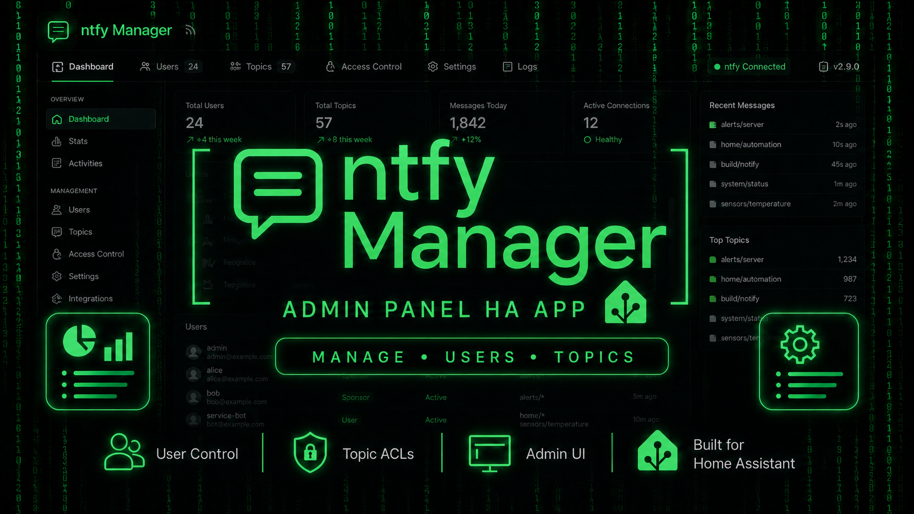

<div align="center">



# 🛠️ ntfy Manager — Home Assistant App

Full admin control panel for an ntfy server running as a HAOS add-on.

[](https://github.com/pol4rfuchs/ha-apps)
[](https://github.com/pol4rfuchs/ha-apps)
[](https://www.home-assistant.io/addons/)
[](https://github.com/binwiederhier/ntfy)
[](https://www.home-assistant.io/addons/)

</div>

---

## 🧭 Overview

| Property | Value |
|---|---|
| **HA Add-on Slug** | `ntfy_manager` |
| **App Version** | `0.2.17` |
| **Web UI Port** | `8099` (Ingress) |
| **Talks to** | `ntfy` add-on (same repo) |
| **Persistence** | `/data/jwt_secret` |

---

## Features

### Pages
- **Overview** — health, version, stats, uptime, user count, system status indicators
- **Send** — topic + title + priority + tags + click + live preview, example loader
- **Users** — list + create + delete + change password
- **Tokens** — create tokens with an optional label & expiry, clipboard copy
- **Access Control** — permission matrix with user selector, topic + permission, delete
- **Reservations** — topic reservation with the correct `{topic, everyone}` body
- **Server** — health/version info + auto-generated HA `rest_command` YAML snippet
- **Messages** — multi-topic polling with stats, since/limit filters, topic settings via localStorage
- **Debug** — SSE monitor (connect/reconnect/disconnect counters, live log) + in-memory audit feed

### Architecture
- **HA Add-on** — `ghcr.io/hassio-addons/base` (Alpine + s6-overlay + bashio)
- **Ingress sidebar panel** on port 8099, optional direct access
- **Frontend** — React 18 + Vite + Tailwind, single-bundle SPA
- **Backend** — Express 4 + Zod + AES-256-GCM for stateless cookie sessions
- **Auth** — the login form writes an encrypted cookie with the ntfy credentials, or loads defaults from the add-on config
- **No second user DB** — the ntfy `user.db` is the single source of truth
- **No bcrypt, no Prisma** — the only persistence is `/data/jwt_secret`
- **SSE bridge** through nginx → Express → ntfy `/sse` (passed through, no buffering)

## Architecture

```
┌──────────────────────────────────────────────────────┐
│ HAOS Add-on Container (Alpine + s6)                  │
│                                                      │
│  ┌──────────┐         ┌──────────────┐               │
│  │  nginx   │ ─────►  │ Express API  │               │
│  │  :8099   │ /api/*  │ :3000        │               │
│  │  (SPA)   │         │              │               │
│  └──────────┘         └──────┬───────┘               │
│       │                      │                       │
│       │ Ingress               │ HTTP                 │
│       ▼                      ▼                       │
│   Browser              ntfy:4280 (other add-on)      │
│                                                      │
└──────────────────────────────────────────────────────┘
```

## Installation

1. Add the repository to Home Assistant: `https://github.com/pol4rfuchs/ha-apps`
2. Install the add-on.
3. Configure — either enter the ntfy credentials directly in the add-on, or leave them empty for an interactive login.
4. Start — the sidebar entry "ntfy Admin" appears.

## Add-on Configuration

| Option | Default | Description |
|--------|---------|--------------|
| `ntfy_base_url` | `http://homeassistant.local:4280` | URL of the ntfy server |
| `ntfy_auth_type` | `basic` | `none`, `basic` or `bearer` |
| `ntfy_username` | `""` | Default username (for `basic`) |
| `ntfy_password` | `""` | Default password (for `basic`) |
| `ntfy_bearer_token` | `""` | Default token (for `bearer`) |
| `default_topics` | `[ha-alerts, ha-info, ha-notify, ha-system, ha-planty]` | Default topics for Messages/SSE |
| `allow_login_override` | `true` | Allows an interactive login in addition to the defaults |

## Auth flow

1. The add-on starts → `/data/jwt_secret` is generated once.
2. The browser opens the panel → calls `/api/auth/status`.
3. If ntfy credentials are set in the add-on config: logged in automatically.
4. If not: login form — the user enters the ntfy credentials.
5. The backend validates against ntfy via `GET /v1/account`.
6. On success: AES-256-GCM-encrypted cookie with the ntfy Authorization header.
7. All further calls go through the backend proxy with the cookie auth.

## Security

- The cookie is `httpOnly`, `sameSite: lax`, AES-256-GCM-encrypted with an AEAD tag.
- `JWT_SECRET` is generated once on the first start in `/data/jwt_secret` (mode 0600).
- ntfy credentials are NEVER stored in LocalStorage.
- The backend makes all ntfy calls server-to-server; the frontend only talks to `/api/*`.
- The audit log is in-memory only (max 500 entries), and goes to the Supervisor log via console.

## Architectural Notes

- **No Prisma, no SQLite, no user store.** If you want token auth — use ntfy directly.
- **No setup wizard** like in the old skeleton — in v0.1 it was the login system for the non-existent own user DB. No longer needed.
- **Reservation bug** of the old HTML panel is fixed: POST `/v1/account/reservation` with `{topic, everyone}` in the body, not in the path.
- **SSE runs via `EventSource`** on the browser side + `fetch` with a stream reader in the backend. nginx adjusts the buffer (`proxy_buffering off`, `chunked_transfer_encoding off`, `proxy_read_timeout 24h`).


---

## 📜 License

The Home Assistant app wrapper, metadata, Dockerfile, scripts,
workflows, frontend, backend and documentation in this directory are
licensed under the Apache License 2.0.

The upstream ntfy project is not relicensed by this repository and remains
under its upstream license.

Upstream:

- ntfy: https://github.com/binwiederhier/ntfy
- Upstream license: See upstream repository

Third-party trademarks, logos, names and assets remain the property of
their respective owners.

See also:

- [`../LICENSE`](../LICENSE)
- [`../NOTICE`](../NOTICE)
- [`../THIRD_PARTY_NOTICES.md`](../THIRD_PARTY_NOTICES.md)
