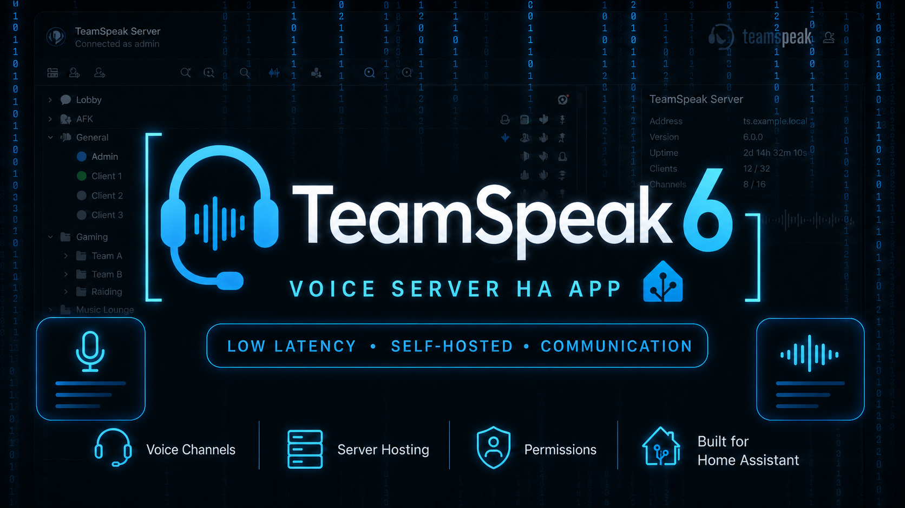

<div align="center">



# 🎙️ TeamSpeak 6 Server — Home Assistant App

**TeamSpeak 6 voice server as a Home Assistant app, built on the official `teamspeaksystems/teamspeak6-server` image.**

[](https://github.com/pol4rfuchs/ha-apps)
[](https://teamspeak.com)
[](https://www.home-assistant.io/addons/)

</div>

---

## 🧭 Overview

| Property | Value |
|---|---|
| **Server** | TeamSpeak 6 Server (`teamspeaksystems/teamspeak6-server`, version pinned in the Dockerfile) |
| **Architectures** | `amd64`, `aarch64` |
| **App version** | `1.1.26` |
| **Voice port** | `9987/udp` |
| **File transfer** | `30033/tcp` |
| **ServerQuery** | `10022/tcp` (SSH), `10080/tcp` (HTTP) |
| **Data** | `/data/teamspeak6` (included in Home Assistant backups, except the log files in logs/) |

---

## 🚀 Installation

1. Add the repository in Home Assistant:

   ```text
   Settings → Apps → App Store → ⋮ → Repositories
   ```

   ```text
   https://github.com/pol4rfuchs/ha-apps
   ```

2. Install **TeamSpeak 6 Server**.
3. In the Configuration tab set **Accept TeamSpeak License** (`license_accepted`) to `true`. The app refuses to start otherwise.
4. Start the app and open the **Log** tab (see *First start* below).
5. Connect with your TeamSpeak 6 client to `<ha-host>:9987`.

---

## ⚙️ Configuration

| Option | Default | Description |
|---|---|---|
| `license_accepted` | `false` | Must be `true`: you accept the TeamSpeak server license. |
| `query_admin_password` | — | Password of the ServerQuery login `serveradmin`. **Set it.** It is applied at every start, so it also works if you add or change it later (tested). If empty, TeamSpeak generates one on the first start; the app hides it in the log, so you cannot read it. |
| `log_level` | `3` | TeamSpeak log level, `0`–`4` (higher is more verbose). |

The ports are fixed. Server name, server password and slot count are set in the TeamSpeak client or through ServerQuery, not in the app options.

---

## 🌐 Ports

| Port | Protocol | Purpose |
|---|---|---|
| `9987` | UDP | Voice |
| `30033` | TCP | File transfer |
| `10022` | TCP | ServerQuery (SSH) |
| `10080` | TCP | ServerQuery (HTTP) |

Only `9987/udp` (and `30033/tcp` for file transfer) are meant to be forwarded on your router for friends outside your network. Keep the two ServerQuery ports inside your LAN or behind a VPN. See *Local and external access* in [DOCS.md](DOCS.md).

---

## 🔑 First start

On the first start the log shows two things you need:

- the **privilege key (token)**: `token=…` — paste it in the client under **Permissions → Use Privilege Key** to become server admin. It is shown **only once**.
- a note that the generated ServerQuery password and API key are **not** shown (the app hides them). To use ServerQuery, set `query_admin_password` and restart the app.

If you missed the token, create a new one through ServerQuery:

```bash
ssh -p 10022 serveradmin@<ha-host>
# password: your query_admin_password
use sid=1
tokenadd tokentype=0 tokenid1=6 tokenid2=0
```

TeamSpeak 6 (version 6.0.0-beta13.1) has no raw ServerQuery port (`10011`, telnet) any more: the server only offers SSH, HTTP and HTTPS query interfaces (checked in the server's `--help` and by connecting to the running server: nothing listens on `10011`). This app enables SSH and HTTP.

---

## 💾 Data and backup

```text
/data/teamspeak6/
├── server/             ← persistent copy of the server data
│   ├── tsserver.sqlitedb
│   ├── ssh_host_rsa_key
│   ├── query_ip_allowlist.txt
│   ├── query_ip_denylist.txt
│   └── files/
├── logs/               ← server logs (cleared on every start, log files not in backups)
└── .token_was_shown    ← marker: the token was already printed
```

TeamSpeak works on a copy in `/var/tsserver` inside the container. The app restores it from `/data/teamspeak6/server` on start and writes it back **every 5 minutes** (a consistent copy of the running database) and when the app is stopped cleanly. After a crash or power loss you lose at most the last five minutes of changes. The Home Assistant backup contains `/data` except the log files in `logs/`.

---

## 🔧 Troubleshooting

| Problem | Fix |
|---|---|
| App stops right after start | `license_accepted` is `false`. |
| Token missed | Create a new one through ServerQuery (see above). |
| Clients outside the LAN cannot connect | Forward `9987/udp` (and `30033/tcp`) to the Home Assistant host. |
| Port already in use | Another service uses the port; change the host port in the app's **Network** tab. |

---

## 📜 License

The Home Assistant app wrapper, metadata, Dockerfile, scripts,
workflows and documentation in this directory are licensed under the
Apache License 2.0.

The upstream TeamSpeak 6 Server software is not relicensed by this
repository and remains subject to the TeamSpeak Server License Agreement.

Upstream:

- TeamSpeak 6 Server: https://github.com/teamspeak/teamspeak6-server
- Vendor legal terms: https://teamspeak.com/en/privacy-and-legal/ts-server-license-agreement/

Third-party trademarks, logos, names and assets remain the property of
their respective owners.

See also:

- [`../LICENSE`](../LICENSE)
- [`../NOTICE`](../NOTICE)
- [`../THIRD_PARTY_NOTICES.md`](../THIRD_PARTY_NOTICES.md)
